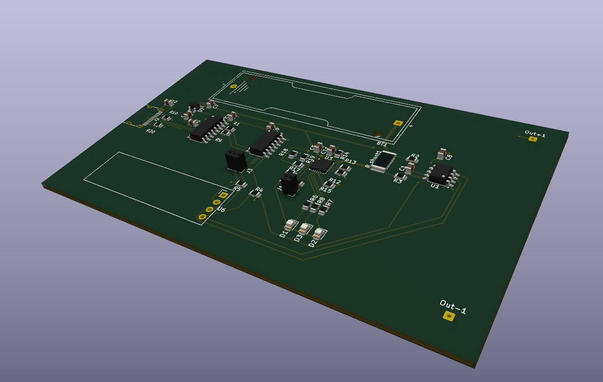

# USB-C Smart Li-ion Charger with Live Battery Monitor

A compact single-cell Li-ion/LiPo charger powered over USB-C, with a built-in monitor that shows battery voltage and charge current on a small OLED. The project is designed end to end in KiCad, covering component selection, schematic capture, and PCB layout, and serves as a reference design for small portable power systems.

## Overview

Most low-cost chargers charge a battery and reveal nothing about what is happening. This design adds visibility: voltage and current are measured and displayed in real time while charging, and the power-path architecture lets the board supply a load at the same time.

## Features

- USB-C power input
- Single-cell Li-ion/LiPo charging using the MCP73871 charge management IC, with power-path control
- Voltage and current sensing using an INA219 and a shunt resistor over I2C
- ATtiny1614 microcontroller that reads the sensor and drives a 0.91" I2C OLED
- CH340C USB-to-UART bridge for programming and serial debugging
- AMS1117-3.3 regulator for the logic supply

## Design Approach

The board is split into three functional blocks: power and charging, measurement, and control and display.

Component values were selected around the following:

- **Charge current:** 1 A, set by R_PROG1 = 1 kΩ on the MCP73871 (I = 1000 / R_PROG1 in kΩ)
- **Current sensing:** shunt resistance matched to the INA219 input range
- **Logic supply:** 3.3 V rail from the AMS1117-3.3

The layout is a compact 2-layer board, with attention to current-carrying traces and the placement of the sense resistor.

## Tools

- KiCad for schematic and PCB design
- Arduino/megaTinyCore for ATtiny1614 firmware

## Repository Contents

- `battery charger/`: KiCad project files (schematic and PCB)
- `pcb.png`: PCB layout screenshot
- `pcb view.png`: PCB view screenshot
- `README.md`: project description

## Status

Schematic and PCB layout complete. Not yet fabricated or tested. Photos and measured results will be added after the board is built and tested.

